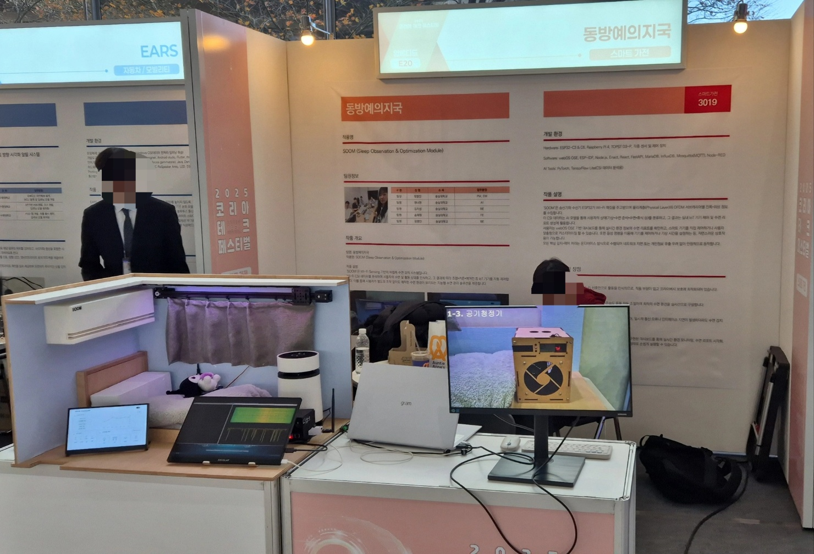
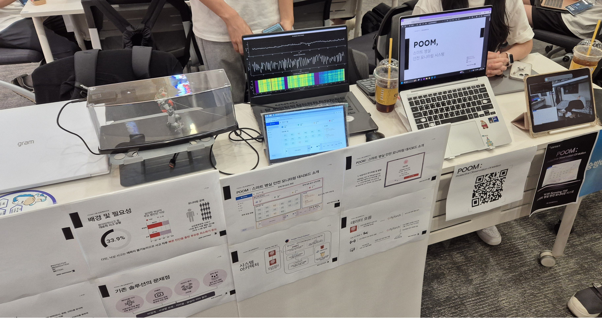

<h1 align="center">Youngjin Won</h1>

## 🏆 Prize

🏆 *2026.10*: [**DevDay Exchange Community Hackathon:Seoul**](https://luma.com/f7h7onav?tk=X1NZVk)  
**🥇 Track2 – 1위**
- Project: [VIDEX (VIsion + coDEX)](https://github.com/kimssammwu/videx) (시각장애인·저시력자를 위한 AI 시각보조 스마트 안경)
- Sector: ​Track 2. AI for Human Life — 일상을 바꾸는 AI
- Team: 생일파티
- Part: Hardware & Embedded System
- Organization: Codex Ambassador (행사 총괄), BITAmin·프로메테우스·가짜연구소(공동 주관 커뮤니티), OpenAI·AWS·Monster Energy(스폰서)

---

🏆 *2025.12*: [**2025 제23회 임베디드 소프트웨어 경진대회**](https://scatch.ssu.ac.kr/%eb%89%b4%ec%8a%a4%ec%84%bc%ed%84%b0/%ec%a3%bc%ec%9a%94%eb%89%b4%ec%8a%a4/?slug=%EB%8F%99%EB%B0%A9%EC%98%88%EC%9D%98%EC%A7%80%EA%B5%AD%ED%8C%80-%EC%9E%84%EB%B2%A0%EB%94%94%EB%93%9C-sw-%EA%B2%BD%EC%A7%84%EB%8C%80%ED%9A%8C-%EA%B8%88%EC%83%81&f=all&keyword=%EB%8F%99%EB%B0%A9%EC%98%88%EC%9D%98%EC%A7%80%EA%B5%AD)  
**🥇 금상 – LG전자 CTO상**
- Project: [SOOM (Sleep Observation & Optimization Module)](https://github.com/Dongbang-Yeuijiguk/2025ESWContest_smart_3019) (Wi-Fi Sensing 기반 비접촉 수면 감지 시스템)
- Sector: [스마트 가전 부문](https://www.eswcontest.or.kr/competition/webos.php) (LG전자 후원)
- Team: 동방예의지국
- Part: Team Leader · Project Manager · Embedded System 
- Organization: 산업통상자원부(주최), KESSIA-임베디드소프트웨어·시스템산업협회(주관)

---

🏆 *2025.08*: [**2025 교내 연합 해커톤 UNITHON**](https://www.instagram.com/p/DLERFP8SP3v/?utm_source=ig_web_copy_link&igsh=NTc4MTIwNjQ2YQ==)  
**🥉 우수상 – 스파르탄SW교육원 원장상**
- Project: [POOM (Protective Observation Of Motion)](https://github.com/Soongbang-Yeuijiguk) (Wi-Fi Sensing 기반 스마트 병실 안전 모니터링 시스템)
- Team: 숭방예의지국
- Part: Project Manager · Embedded System · Business strategy
- Organization: 숭실대학교 IT대학 학생회(주최), 숭실대학교 창업지원단·스파르탄SW교육원(주관)

---

## 🎤 Exhibition

📢 *2025.12.03~05* [**2025 제23회 임베디드 소프트웨어 경진대회**](https://scatch.ssu.ac.kr/%eb%89%b4%ec%8a%a4%ec%84%bc%ed%84%b0/%ec%a3%bc%ec%9a%94%eb%89%b4%ec%8a%a4/?slug=%EB%8F%99%EB%B0%A9%EC%98%88%EC%9D%98%EC%A7%80%EA%B5%AD%ED%8C%80-%EC%9E%84%EB%B2%A0%EB%94%94%EB%93%9C-sw-%EA%B2%BD%EC%A7%84%EB%8C%80%ED%9A%8C-%EA%B8%88%EC%83%81&f=all&keyword=%EB%8F%99%EB%B0%A9%EC%98%88%EC%9D%98%EC%A7%80%EA%B5%AD)  

- Project: [SOOM (Sleep Observation & Optimization Module)](https://github.com/Dongbang-Yeuijiguk/2025ESWContest_smart_3019) (Wi-Fi Sensing 기반 비접촉 수면 감지 시스템)
- Location : 2025 코리아 테크 페스티벌  
    

---

📢 *2025.08.13* [**2025 교내 연합 해커톤 UNITHON**](https://www.instagram.com/p/DLERFP8SP3v/?utm_source=ig_web_copy_link&igsh=NTc4MTIwNjQ2YQ==)  

- Project: [POOM (Protective Observation Of Motion)](https://github.com/Soongbang-Yeuijiguk) (Wi-Fi Sensing 기반 스마트 병실 안전 모니터링 시스템)
- Location : 숭실대학교 한경직기념관 김덕윤 예배실  
    

---

## 💻 Project

| Period | Project | Description | Stack & Role |
| :--- | :--- | :--- | :--- |
| 2022.07 ~ present | [**SSCCounter**](https://github.com/SoongSilComputingClub/SSCCounter) *(Indoor Occupancy Counter)* | **동아리방 이용자 수 확인 시스템** YOLOv8 기반 실시간 인원 카운팅 | `Python` `YOLOv8` **FullStack** |
| 2025.12 ~ 2026.03 | [**SSCC Web Page**](https://app.sscc-ssu.com) | **동아리 웹 페이지** 2026 신입 부원 모집 페이지 | `On-premise` **PM**, Infra |
| 2025.03 ~ 2025.09 | [**SSCCtal**](https://github.com/SSCC-Library) *(Club Library System)* | **동아리 도서 대여 키오스크** 바코드 스캔 및 대여 현황 웹 대시보드 | `ESP32` `Websocket` **PM**, Kiosk System |
| 2022.11 ~ 2022.12 | [**Smart-Home System**](https://github.com/AI-WonYJ/Smart-Home) | **스마트홈 시스템** 센서 데이터 대시보드 및 가전 제어 | `Arduino` `C++` **FullStack** |

---

## ⚒️ Tech Stack

  
  
  
  
  
  
  
  
  
  

---

## 📊 Stats

 

 

---